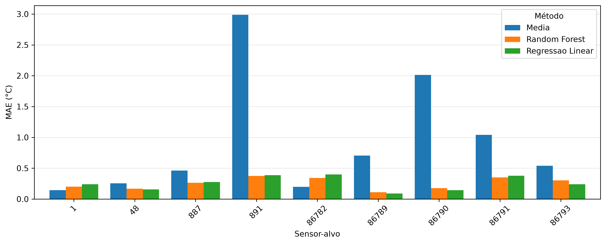

# Reconstrução virtual de temperaturas com sensores IoT

Código, dados e resultados do TCC **Reconstrução virtual de temperaturas a partir de sensores IoT no LASDPC**, de **Gustavo Moura Scarenci de Carvalho Ferreira**, orientado pelo **Prof. Dr. Júlio Cezar Estrella**, no ICMC/USP (2026).

O estudo avalia a estimativa da temperatura de um sensor físico a partir das medições simultâneas dos demais sensores no ambiente 1006 do LASDPC. Compara média aritmética, regressão linear e Random Forest; investiga quantidade de entradas, seleção por correlação e proximidade, e inclusão de umidade relativa.

**Comece pelo [PDF atualizado do TCC](new_thesis/TCC_GustavoMoura_atualizado%20%285%29.pdf) e pelos [experimentos consolidados](code/tcc/README.md).** O PDF e o ZIP importados do Overleaf em `new_thesis/` são a referência da entrega atual. Os fontes em `thesis/paper/` pertencem à versão local anterior e não devem ser usados para reconstruir essa entrega.

## Resultados principais

| Método | MAE médio (°C) | Média dos RMSE (°C) | R² médio |
|---|---:|---:|---:|
| Média aritmética | 0,927 | 0,991 | −2,362 |
| Regressão linear | 0,257 | 0,325 | 0,850 |
| Random Forest | 0,254 | 0,332 | 0,852 |

As métricas são médias aritméticas das avaliações individuais dos nove sensores-alvo, com oito sensores de entrada por alvo. Os valores completos estão em [resumo_modelos.csv](code/tcc/results/experimentos/tabelas/resumo_modelos.csv). O desempenho varia por alvo; a diferença agregada entre os modelos supervisionados não demonstra superioridade estatística.

Na análise da quantidade de entradas, quatro sensores selecionados por correlação no treinamento obtiveram o menor MAE médio observado (0,238 °C). Essa quantidade foi identificada ao examinar o teste e não constitui uma escolha validada em um teste independente. A umidade reduziu o MAE médio de 0,25668 °C para 0,25343 °C em amostras pareadas, com melhora em cinco dos nove alvos.



## Organização do repositório

| Caminho | Conteúdo e finalidade |
|---|---|
| [`new_thesis/`](new_thesis/) | PDF atualizado e projeto original exportado do Overleaf em ZIP; referência da entrega |
| [`code/tcc/`](code/tcc/) | Seis notebooks numerados, dependências e scripts da avaliação consolidada |
| [`code/tcc/data/raw/`](code/tcc/data/raw/) | Extrações preservadas, consultas SQL e metadados de origem; o QuestDB já está agregado em cinco minutos |
| [`code/tcc/data/processed/`](code/tcc/data/processed/) | Matrizes sincronizadas de temperatura, umidade, energia e contagens |
| [`code/tcc/data/metadata/`](code/tcc/data/metadata/) | Inventário, disponibilidade e auditoria de pré-processamento |
| [`code/tcc/results/`](code/tcc/results/) | Tabelas, figuras, previsões e configurações dos experimentos |
| [`code/sensores.json`](code/sensores.json), [`code/sensorsWithCoordinates`](code/sensorsWithCoordinates) | Cadastro dos dispositivos e coordenadas relativas |
| `code/final.ipynb`, `code/main2.ipynb`, `code/novo.ipynb` | Explorações anteriores; podem usar protocolos distintos do TCC |
| [`thesis/`](thesis/) | Proposta, artigos de apoio, modelo e fontes locais anteriores |
| [`docs/avaliacao-tcc.md`](docs/avaliacao-tcc.md) | Avaliação do texto, dos códigos e da rastreabilidade da entrega |

Os caminhos existentes foram mantidos porque notebooks, scripts e manifestos fazem referência a eles.

## Protocolo experimental

- **Fonte principal:** QuestDB, ambiente 1006, nove sensores: `1`, `48`, `887`, `891`, `86782`, `86789`, `86790`, `86791`, `86793`.
- **Período consultado:** de 10/06/2026 00:00 UTC, inclusive, a 26/07/2026 00:00 UTC, exclusive.
- **Preparação:** médias em cinco minutos; 13.248 janelas previstas, 12.892 completas e 356 excluídas; sem imputação.
- **Divisão:** cronológica, sem embaralhamento; 9.024 amostras de treinamento e 3.868 de teste. O teste começa em 11/07/2026 às 16:00 UTC.
- **Reconstrução:** o sensor-alvo é retirado das entradas; as temperaturas dos demais sensores pertencem ao mesmo instante do alvo. Trata-se de reconstrução contemporânea, não de previsão futura.
- **Seleção:** correlação de Pearson calculada apenas no treinamento. A análise espacial compara correlação e distância euclidiana entre seis sensores com coordenadas.
- **Extensões:** umidade em comparação pareada por alvo; energia apenas exploratória, com 539 janelas e unidade física não confirmada.

A API Smartlab é uma fonte exploratória separada. Seus timestamps e sua resolução não foram equiparados aos do QuestDB. O mapa IDW representa médias e tem finalidade ilustrativa; não valida temperaturas em posições sem sensores.

## Preparar o ambiente

Execute os comandos a partir da raiz do repositório. O ambiente registrado na execução consolidada usa **Python 3.12.3**; as versões diretas estão em [`requirements.txt`](code/tcc/requirements.txt).

```bash
python3 -m venv .venv
.venv/bin/python -m pip install -r code/tcc/requirements.txt
.venv/bin/python -m ipykernel install --user --name temperature-monitoring
```

Abra os notebooks em um editor com suporte a Jupyter e selecione o kernel `temperature-monitoring`. O arquivo de dependências inclui o kernel, mas não instala uma interface como JupyterLab.

## Conferir os resultados preservados

```bash
.venv/bin/python code/tcc/verificar_resultados.py
```

Essa conferência funciona com os arquivos locais: recalcula MAE, RMSE e R² das previsões salvas e verifica hashes específicos, amostras, exclusão do alvo e máscara espacial. Não treina modelos nem consulta servidores. O [manifesto de reprodução](code/tcc/manifesto_reproducao.json) registra separadamente hashes de 178 arquivos da versão consolidada; não inclui a entrega importada em `new_thesis/`.

## Executar os experimentos

| Ordem | Notebook | Função |
|---|---|---|
| 02 | [`02_preprocessamento.ipynb`](code/tcc/02_preprocessamento.ipynb) | Validar a extração e construir as matrizes temporais |
| 03 | [`03_experimentos.ipynb`](code/tcc/03_experimentos.ipynb) | Comparar os três métodos e a quantidade de entradas |
| 04 | [`04_analise_espacial.ipynb`](code/tcc/04_analise_espacial.ipynb) | Comparar critérios de seleção e gerar o mapa ilustrativo |
| 05 | [`05_umidade.ipynb`](code/tcc/05_umidade.ipynb) | Caracterizar umidade e avaliar seu acréscimo às entradas |
| 06 | [`06_energia_exploratoria.ipynb`](code/tcc/06_energia_exploratoria.ipynb) | Auditar disponibilidade e escala do campo `energy` |

Execute todas as células de cada notebook nessa ordem. Mantenha `ATUALIZAR_EXTRACAO = False` no 02 e `ATUALIZAR = False` no 05 e no 06. Com os caches presentes, esse fluxo utiliza dados locais. A execução regrava resultados e metadados; use uma cópia do repositório para preservar os artefatos entregues.

O [`01_exploracao_dados.ipynb`](code/tcc/01_exploracao_dados.ipynb) registra a exploração da Smartlab e não é necessário para reproduzir os resultados consolidados com os arquivos presentes. Sua execução integral exige acesso à API e autenticação por `SMARTLAB_USERNAME` e `SMARTLAB_PASSWORD`, ou entrada interativa. O código não carrega `.env` automaticamente. Não salve credenciais nem tokens nas células ou saídas.

A exportação de tabelas e figuras para `thesis/paper/` é um procedimento da versão local anterior, descrito no [README técnico](code/tcc/README.md). Ela não atualiza o ZIP ou o PDF da entrega do Overleaf.

## Alcance dos resultados

A avaliação considera um ambiente, um período e uma divisão temporal, apenas em janelas com todas as temperaturas disponíveis. Não valida falhas simultâneas das entradas, generalização para outros ambientes, exatidão metrológica, conforto térmico ou economia de energia. Não foram calculados intervalos de confiança ou testes de significância.

O campo `energy` permanece na escala do banco e não deve ser interpretado como kWh, W ou A. As coordenadas e divisórias são aproximações. As limitações e sugestões para continuidade estão detalhadas no TCC e na [avaliação técnica](docs/avaliacao-tcc.md).

## Referência acadêmica

Ao mencionar este estudo, utilize os dados bibliográficos do PDF atualizado e identifique a revisão do repositório utilizada. Sugestão de referência:

> FERREIRA, Gustavo Moura Scarenci de Carvalho. **Reconstrução virtual de temperaturas a partir de sensores IoT no LASDPC**. Monografia (Graduação em Engenharia de Computação) — Instituto de Ciências Matemáticas e de Computação, Universidade de São Paulo, São Carlos, 2026.

Repositório: <https://github.com/GuScarenci/temperatureMonitoring>.
